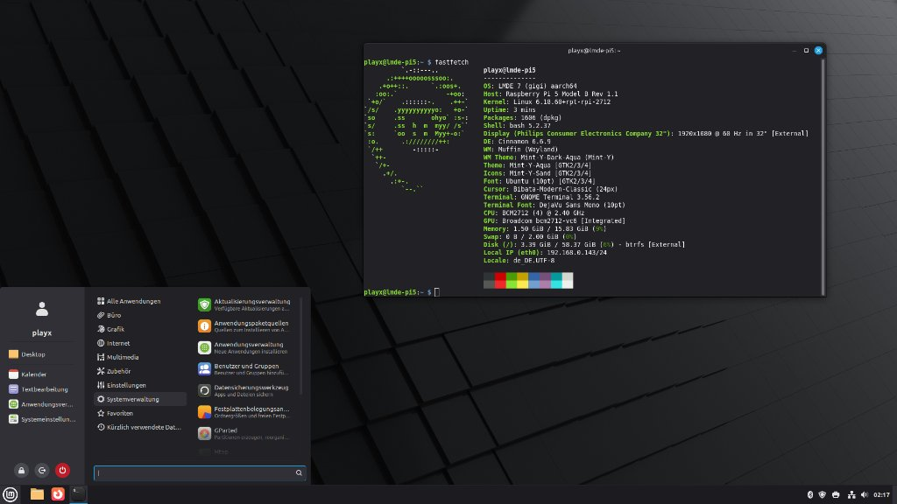

# LMDE 7 ARM64 — Linux Mint Debian Edition for Raspberry Pi 5 & CM5 🍓🍃

[](https://github.com/GamingTux/lmde-arm64/releases)
[](https://github.com/GamingTux/lmde-arm64/actions/workflows/build-image.yml)
[](https://github.com/GamingTux/lmde-arm64/actions/workflows/build.yml)
[-blue?style=flat-square)](https://github.com/GamingTux/lmde-arm64)
[](https://www.linuxmint.com/)
[](https://wayland.freedesktop.org/)
[-8A2BE2?style=flat-square)](https://github.com/raspberrypi/linux)
[](https://btrfs.readthedocs.io/)
[](LICENSE)

> **Experience the elegance of Linux Mint Debian Edition (LMDE 7 "Gigi") on the Raspberry Pi 5.**  
> An authentic, upstream-faithful Linux Mint desktop running on a modern **100% pure Wayland** display stack, natively compiled and tuned for the **Broadcom BCM2712 (ARM Cortex-A76)** architecture with **Btrfs snapshot support**, VideoCore VII GPU acceleration, and a dedicated GPG-signed APT repository.

<p align="center">
  
</p>
<p align="center">
  <em>LMDE 7 Cinnamon 6.6 on Wayland running on Raspberry Pi 5 Model B (BCM2712 Cortex-A76 @ 2.40 GHz) with Fastfetch and the official Linux Mint menu.</em>
</p>

---

## 🌟 Overview & Why LMDE 7 ARM64?

**Linux Mint** is world-renowned for its clean aesthetic, polished user interface, rock-solid stability, and intuitive Cinnamon desktop. While the Linux Mint development team does not provide an official ARM64 release for single-board computers, **lmde-arm64** delivers an authentic, pure **LMDE 7 ("Gigi")** workstation environment built specifically for the **Raspberry Pi 5**, **Compute Module 5 (CM5)**, and **Raspberry Pi 500**:

* **🍃 100% Genuine Linux Mint Experience:** Unmodified, authentic Mint experience featuring the official `mint-logo` Plymouth boot splash, `Mint-Y` dark and light themes, icons, `mint-artwork` wallpapers, `debian-system-adjustments`, and the complete Linux Mint XApps suite.
* **🪟 Modern Pure Wayland Architecture:** Completely free of legacy Xorg server overhead. Boots directly through a Wayland LightDM greeter (`pi-greeter-labwc`) into `cinnamon-wayland` on Raspberry Pi's native KMS/DRM VideoCore VII driver stack, with seamless `xwayland` support for legacy tools and root administrative utilities.
* **⚡ Native Cortex-A76 Optimization:** Includes a dedicated GPG-signed APT repository featuring over **290+ natively compiled system, multimedia, and desktop packages** built specifically for ARMv8.2-A with Crypto, FP16, and Dot Product extensions (`-mcpu=cortex-a76+crypto`), 16 KB ELF memory page alignment, and VideoCore VII-optimized Mesa drivers.
* **🗄️ Resilient Btrfs Storage + Timeshift:** Root filesystem formatted with Btrfs featuring transparent `zstd:1` compression, automatic partition expansion on first boot, and instant copy-on-write system snapshots via **Timeshift**.
* **🚀 Zero Bloatware & Adaptive Hardware Tuning:** No invasive theme forks or restrictive kernel hacks. Adaptive I/O writeback prevents freezes on USB flash drives while allowing NVMe SSDs to run at full unthrottled PCIe speeds.

---

## 📥 Downloads & Quick Start

Pre-built, ready-to-flash images are automatically built, signed, and published via GitHub Actions.

| Image Asset | Target Architecture | RootFS | Download Link |
| :--- | :---: | :---: | :--- |
| **LMDE 7 ARM64 (Pi 5 / CM5)** | `aarch64` (BCM2712) | Btrfs (`zstd:1`) | [Latest GitHub Release](https://github.com/GamingTux/lmde-arm64/releases/latest) |
| **SHA-256 Checksums** | All Assets | — | [SHA256SUMS.txt](https://github.com/GamingTux/lmde-arm64/releases/latest/download/SHA256SUMS.txt) |

### ⚡ Flashing Instructions

1. **Download the latest image** (`image_*-lmde-arm64-pi5-cinnamon-btrfs.img.xz`) from the [Releases](https://github.com/GamingTux/lmde-arm64/releases) page.
2. **Flash the compressed image** directly to your MicroSD card, USB stick, or NVMe SSD using your preferred tool:
   * **Raspberry Pi Imager:** Choose *Use Custom* and select the `.img.xz` file.
   * **BalenaEtcher:** Select the `.img.xz` archive and choose your target drive.
   * **Command Line (`dd`):**
     ```bash
     xzcat image_*-lmde-arm64-pi5-cinnamon-btrfs.img.xz | sudo dd of=/dev/sdX bs=4M status=progress conv=fsync
     ```
     *(Replace `/dev/sdX` with your target block device — be sure to verify your disk with `lsblk`).*
3. **Insert the media into your Raspberry Pi 5 and power on.**
   * On first boot, the system automatically expands the Btrfs partition to fill the full storage capacity and prompts you through a quick 5-step initial setup wizard (language, keyboard layout, timezone, Wi-Fi, and user account creation).

---

## 🚀 Key Highlights & Architecture

### 🍃 Complete Linux Mint Software & Utilities Suite
All signature Linux Mint applications and administrative tools are pre-installed and ready to use:
* **Timeshift:** Instant, zero-latency system snapshots and rollbacks powered by native Btrfs subvolumes.
* **Software Manager (`mintinstall`):** Graphic software catalog with integrated **Flatpak / Flathub** support.
* **Update Manager (`mintupdate`):** Automatic security patches, package upgrades, and system notification applet.
* **Desktop Essentials:** Nemo file manager, MintSources (software repository manager), MintWelcome, MintStick (USB formatter & image flasher), MintReport (system reports & diagnostic tool), MintBackup, MintLocale (language manager), Warpinator (LAN file transfer), Gufw firewall, Bulky (batch file renamer), Sticky Notes, Folder Color Switcher, and Thingy (document organizer).
* **Multimedia & Internet:** Firefox with official `rpi-firefox-mods` and Widevine DRM streaming support, Celluloid media player, Hypnotix IPTV streamer, Pix image viewer, and Drawing.

### 🪟 100% Xorg-Free Pure Wayland Stack
* **Wayland Compositor:** Runs Cinnamon 6.6 with Muffin under Wayland, utilizing VideoCore VII KMS/DRM for tear-free rendering and low latency.
* **LightDM Wayland Greeter:** Launches `pi-greeter-labwc` styled with official Mint-Y aesthetics before cleanly passing control to the desktop session.
* **Seamless Compatibility:** `xwayland` runs automatically in the background to guarantee full support for legacy X11 utilities and administrative applications (Synaptic, GParted, Timeshift) without manual configuration.

### ⚡ Cortex-A76 Optimized APT Repository
Over **290+ system, desktop, and multimedia packages** are natively compiled with targeted optimizations:
* **Target Microarchitecture:** `-mcpu=cortex-a76+crypto -O3 -pipe` activating ARMv8.2-A, FP16 half-precision, and Dot Product instructions.
* **16 KB Memory Page Alignment:** Ensures full compatibility with modern high-performance ARM64 Linux kernels.
* **Mesa VideoCore VII:** Pruned strictly to `v3d`, `vc4`, and `broadcom` drivers, eliminating unnecessary desktop GPU bloat for minimal memory footprint and fast startup.
* **Python 3.13 PGO:** Python interpreter built with Profile-Guided Optimization for snappy execution of Cinnamon desktop applets and Mint XApps.

### 🗄️ Btrfs Storage Architecture & Adaptive I/O
* **Transparent Compression:** `compress=zstd:1` maximizes read/write throughput while saving 40–50% storage space, significantly reducing wear on MicroSD and flash drives.
* **Automatic Drive Optimization:**
  * **NVMe SSDs:** Automatically enables continuous asynchronous TRIM (`discard=async`), native Btrfs SSD clustering algorithms, and full unthrottled Linux page-cache buffering.
  * **USB / MicroSD Flash:** Implements targeted udev writeback buffering rules (`bdi/max_bytes = 40MB`) to prevent kernel buffer bloat and system freezes during heavy write operations.
* **Native ZRAM Swap:** Utilizes Raspberry Pi OS's built-in `rpi-swap` mechanism (`Mechanism=zram`), providing fast, compressed in-memory swap without writing swap files to flash storage.

---

## 💻 Hardware Compatibility Matrix

| Hardware | Status | Notes |
| :--- | :---: | :--- |
| **Raspberry Pi 5 (4GB / 8GB / 16GB)** | ✅ Full Support | VideoCore VII OpenGL 3.1 & Vulkan 1.3, dual 4K60 HDMI, PCIe Gen3 NVMe SSD. |
| **Compute Module 5 (CM5)** | ✅ Full Support | Tested on official CM5 IO board and third-party carrier boards. |
| **Raspberry Pi 500** | ✅ Full Support | Fully supported across keyboard, display, and peripheral hardware. |
| **Raspberry Pi 4 / 400 / 3 / Zero 2W** | ❌ Unsupported | Cortex-A76 binaries require ARMv8.2-A instructions and will fail with `Illegal instruction` (SIGILL). |

---

## 🎛️ APT Repository & Package Priorities

The operating system combines four package streams using strict APT pinning priorities to ensure optimal performance, stability, and seamless updates:

```text
/etc/apt/preferences.d/lmde-pi5.pref:

Package: *
Pin: origin "gamingtux.github.io"
Pin-Priority: 1001

Package: *
Pin: origin "archive.raspberrypi.com"
Pin-Priority: 1000

Package: *:amd64
Pin: origin "packages.linuxmint.com"
Pin-Priority: -1

Package: *
Pin: origin "packages.linuxmint.com"
Pin-Priority: 700
```

1. **`gamingtux.github.io` (Priority 1001):** Delivers Cortex-A76 native ARM64 packages (`+pi5`) for Cinnamon, Muffin, Mesa, and system utilities.
2. **`archive.raspberrypi.com` (Priority 1000):** Supplies the official Raspberry Pi kernel (`linux-image-rpi-2712`), bootloader, EEPROM, and VideoCore VII firmware.
3. **`packages.linuxmint.com` (`*:amd64` Priority -1):** Safely blocks non-native `amd64` binary packages.
4. **`packages.linuxmint.com` (Priority 700):** Delivers upstream architecture-independent (`Architecture: all`) packages (`mintupdate`, `mintinstall`, `mintsources`, `mint-artwork`, `mint-themes`, `mint-y-icons`).
5. **`deb.debian.org` (Priority 500 / default):** Supplies the complete Debian 13 (Trixie) ARM64 software archive.

---

## ❓ Frequently Asked Questions (FAQ)

<details>
<summary><b>Why does LMDE 7 ARM64 run pure Wayland instead of Xorg?</b></summary>
The Raspberry Pi 5's VideoCore VII GPU is architecturally designed around Kernel Mode Setting (KMS) and Direct Rendering Manager (DRM) interfaces optimized for Wayland compositors. Running pure Wayland eliminates screen tearing, reduces display latency, and lowers memory overhead. For legacy applications and root utilities, <code>xwayland</code> runs automatically to provide full compatibility without manual intervention.
</details>

<details>
<summary><b>How do I enable PCIe Gen 3 for my NVMe SSD?</b></summary>
The operating system image ships with stock Raspberry Pi firmware configurations. If your NVMe HAT and SSD support PCIe Gen 3, add the following lines to <code>/boot/firmware/config.txt</code>:

```ini
dtparam=nvme
dtparam=pciex1_gen=3
```
</details>

<details>
<summary><b>Can I install software via Flatpak and Flathub?</b></summary>
Yes! Flatpak and Flathub are integrated out of the box. You can search and install Flatpaks graphically through the Linux Mint Software Manager (<code>mintinstall</code>) or via the terminal:

```bash
flatpak install flathub <application-name>
```
</details>

<details>
<summary><b>How do I update the operating system?</b></summary>
You can update your system using the standard Linux Mint Update Manager (<code>mintupdate</code>) in the system tray, or via terminal:

```bash
sudo apt update && sudo apt full-upgrade
```
</details>

<details>
<summary><b>Does hardware video decoding work in web browsers?</b></summary>
Yes. The Broadcom BCM2712 SoC features hardware HEVC/H.265 video decoding, while AV1, VP9, and H.264 streams are accelerated using Cortex-A76 NEON SIMD routines. Firefox is pre-configured with <code>rpi-firefox-mods</code> and Widevine DRM for Netflix, Spotify, and YouTube streaming.
</details>

---

## 🏷️ Search Keywords & Tags

`raspberry-pi-5` • `linux-mint-raspberry-pi` • `lmde-7` • `lmde-arm64` • `cinnamon-desktop` • `wayland` • `cinnamon-wayland` • `bcm2712` • `cortex-a76` • `compute-module-5` • `cm5` • `rpi5-desktop` • `btrfs` • `timeshift` • `zstd` • `zram` • `videocore-vii` • `debian-13-trixie`

---

## ⚖️ License & Community Disclaimer

* **License:** Code and build workflows in this repository are licensed under the [MIT License](LICENSE). Software included in the distribution is licensed under their respective upstream licenses (GPL, LGPL, BSD, MIT).
* **Community Project Notice:** *lmde-arm64* is an independent, community-driven open source project developed by GamingTux. It is **not** an official release by Linux Mint, Clement Lefebvre, or Raspberry Pi Ltd., nor is it officially endorsed or sponsored by them. "Linux Mint", "LMDE", "Cinnamon", and "Raspberry Pi" are trademarks of their respective owners.

---

<p align="center">
  <b>Engineered with ❤️ for the Raspberry Pi and Linux Mint communities.</b>
</p>
