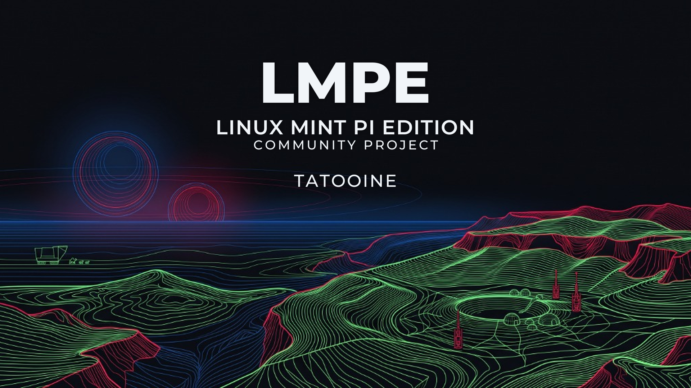

# LMPE — Linux Mint Pi Edition 🍓🍃

[](https://github.com/GamingTux/lmde-arm64/actions/workflows/build.yml)
[](https://github.com/GamingTux/lmde-arm64/actions/workflows/build-image.yml)
[](https://github.com/GamingTux/lmde-arm64/releases)
[-blue?style=flat-square)](https://github.com/GamingTux/lmde-arm64)
[](https://www.linuxmint.com/)
[](https://btrfs.readthedocs.io/)
[](LICENSE)

> **The ultimate Linux Mint experience engineered for Raspberry Pi 5 & Compute Module 5.**  
> Built upon **LMDE 7 ("gigi")** and **Debian 13 Trixie**, LMPE provides a seamless Cinnamon desktop natively compiled and aggressively optimized for the **Broadcom BCM2712 (ARM Cortex-A76)** microarchitecture.

---

<p align="center">
  
</p>

---

## 🌟 Why LMPE?

The official Linux Mint distribution is beloved for its elegance, stability, and intuitive Cinnamon desktop, but **Linux Mint does not offer an official ARM64 / Raspberry Pi image**.

**LMPE (Linux Mint Pi Edition)** bridges this gap. It provides:
1. **Ready-to-Flash Bootable OS Images** with a modern **Btrfs** root filesystem (transparent Zstandard compression).
2. **Dedicated GPG-Signed APT Repository** containing over **160+ packages** recompiled with Cortex-A76 SIMD vectorization and Link-Time Optimization (`-flto=auto`).
3. **Full Raspberry Pi 5 Hardware Acceleration** with VideoCore VII GPU drivers (Mesa OpenGL & Vulkan) and official Raspberry Pi 64-bit kernel integration (`linux-image-rpi-2712`).
4. **Out-of-the-Box PCIe Gen3 NVMe & High-Throughput I/O** pre-configured for lightning-fast desktop responsiveness.

---

## 🚀 Key Features

* **🍃 Complete Linux Mint Cinnamon Desktop:** Cinnamon 6.x desktop, Muffin compositing window manager, Nemo file manager, Slick Greeter, XApps suite (*Xed, Xviewer, Xreader, Pix*), Mint Software Manager (`mintinstall`), MintUpdate, and official Mint themes and icon packs.
* **⚡ Broadcom BCM2712 (Cortex-A76) Tuning:** Core libraries and performance hotspots compiled with:
  ```text
  -march=armv8.2-a+crypto+fp16+dotprod -mtune=cortex-a76 -ftree-vectorize -flto=auto
  ```
* **🗄️ Resilient Btrfs Root Filesystem:** Transparent `zstd:2` compression saves up to 40% disk space, doubles NVMe/SD random read throughput, and significantly extends flash storage endurance.
* **🚀 High-Throughput PCIe Gen3 NVMe & Fast Boot:** Pre-configured PCIe Gen3 transfer modes (`pciex1_gen=3`), optimized NVMe/SD I/O schedulers, and rapid system boot.
* **🎨 OEM Minimal Dark Boot Splash:** Resolution-independent Plymouth bootscreen (`quiet splash`) with custom mint-raspberry emblem and boot spinner.
* **🌐 Modern Networking & I/O Tuning:** Google TCP BBR congestion control, 4-core Receive Packet Steering (RPS), irqbalance GICv2 Level-IRQ core spreading, and NVMe PCIe Gen3 profiles.
* **📦 Automated GitHub Actions Pipeline:** Weekly automated builds check upstream Debian and Linux Mint repositories, build delta packages, sign the repository with GPG, and deploy to GitHub Pages.

---

## 📥 Downloads & Getting Started

### Method 1: Flash Pre-Built Image (Recommended)

1. Download the latest bootable image from **[GitHub Releases](https://github.com/GamingTux/lmde-arm64/releases/latest)**:
   * File: `image_YYYY-MM-DD-lmpe-arm64-pi5-cinnamon-btrfs.img.xz`
2. Flash the `.img.xz` directly using your preferred tool:
   * **[Raspberry Pi Imager](https://www.raspberrypi.com/software/)** (*Use "Use Custom" option*)
   * **[Balena Etcher](https://etcher.balena.io/)**
   * Or via command line:
     ```bash
     xz -dc image_*-lmpe-arm64-pi5-cinnamon-btrfs.img.xz | sudo dd of=/dev/sdX bs=4M status=progress conv=fsync
     ```
3. Insert your MicroSD card or NVMe SSD into your Raspberry Pi 5 / CM5, power on, and enjoy Linux Mint!
   * *On first boot, the Btrfs root filesystem expands automatically to fit your entire drive.*

---

### Method 2: Convert Existing Raspberry Pi OS (Trixie Lite)

If you already have a running installation of **Raspberry Pi OS Lite (64-bit, Debian 13 Trixie)**, you can transform it into LMPE with a single command:

```bash
curl -fsSL https://raw.githubusercontent.com/GamingTux/lmde-arm64/main/setup-pi-lmde.sh | sudo bash
```

Once completed, reboot your system:
```bash
sudo reboot
```

---

## ⚙️ Compiler & Architecture Optimizations

Standard Debian and Ubuntu ARM64 binaries are built using a conservative baseline (`armv8-a`) to guarantee compatibility with old Cortex-A53 chips. 

LMPE compiles packages specifically for the modern **ARM Cortex-A76 core (ARMv8.2-A)** inside the Raspberry Pi 5:

| Optimization Tier | Target Packages | Compiler Flags |
| :--- | :--- | :--- |
| **Stage 0 (`-O3`)**<br>Hotspots & Multimedia | Crypto (`openssl`, `gnutls28`, `nettle`, `libgcrypt20`), Compression (`zstd`, `lz4`, `7zip`, `libarchive`), Graphics & Math (`pixman`, `cairo`, `pango`, `mesa`, `libdrm`, `highway`, `babl`, `gegl`), Media & DSP (`ffmpeg`, `pipewire`, `opus`, `flac`, `dav1d`, `x264`, `x265`, `mpv`, `vlc`, `pulseaudio`), Python 3.13 | `-march=armv8.2-a+crypto+fp16+dotprod -mtune=cortex-a76 -ftree-vectorize -O3` |
| **Stage 1 (`-O2`)**<br>Desktop & UI Stack | Cinnamon Desktop, Muffin Window Manager, Nemo File Manager & Extensions, CJS, XApps (`xed`, `xviewer`, `xreader`, `pix`), Slick Greeter | `-march=armv8.2-a+crypto+fp16+dotprod -mtune=cortex-a76 -ftree-vectorize -flto=auto -ffat-lto-objects -O2` |

Every custom package carries the `+pi5` local version suffix and is signed with the repository GPG key.

---

## 🎛️ APT Repository Configuration

LMPE configures APT pinning so that your system stays updated while strictly prioritizing hardware-accelerated and Cortex-A76 optimized packages:

```text
/etc/apt/preferences.d/lmde-pi5.pref:

Package: *
Pin: origin "gamingtux.github.io"
Pin-Priority: 1001

Package: *
Pin: origin "archive.raspberrypi.com"
Pin-Priority: 1000

Package: *
Pin: origin "packages.linuxmint.com"
Pin-Priority: 700
```

* **`gamingtux.github.io` (Priority 1001):** Highest priority. Delivers Cortex-A76 optimized system packages (`+pi5`).
* **`archive.raspberrypi.com` (Priority 1000):** Protects the official Raspberry Pi kernel (`linux-image-rpi-2712`), bootloader, EEPROM, firmware, and VideoCore VII GPU drivers.
* **`packages.linuxmint.com` (Priority 700):** Delivers architecture-independent (`Architecture: all`) Linux Mint components like `mintupdate`, `mintinstall`, `mintsources`, Mint-Y themes, and icons.

---

## 💻 Hardware Compatibility

| Device | Status | Notes |
| :--- | :---: | :--- |
| **Raspberry Pi 5 (4GB / 8GB / 16GB)** | ✅ Full Support | VideoCore VII OpenGL 3.1 / Vulkan 1.3, PCIe Gen3 NVMe, 4K60 dual HDMI. |
| **Raspberry Pi Compute Module 5 (CM5)** | ✅ Full Support | Tested on CM5 IO boards with full PCIe, GPIO, and display connectivity. |
| **Raspberry Pi 4 / 400** | ⚠️ Bootable (Generic) | Can run with generic ARM64 packages, but Cortex-A76 `-O3` binaries will cause illegal instruction exceptions. Use Pi 5 / CM5 for optimal results. |

---

## 🛠️ Repository & Image Build System

The entire operating system image and package repository are 100% open source and reproducible:

* **Repository Builder (`build-repo.sh`):** Fetches upstream Debian/Mint source packages, applies architecture patches, verifies GPG signatures, builds packages with Cortex-A76 flags, strips debug bloat, and updates the signed APT index.
* **OS Image Generator (`pi-gen`):** Custom pi-gen pipeline (`stage3-lmpe`) configuring Btrfs subvolumes, network stack optimizations, hardware runtime tuning, and default Cinnamon desktop profiles.
* **Weekly CI (`.github/workflows/build.yml`):** Automatically polls upstream changes every Monday at 03:00 UTC and performs delta builds to keep packages up-to-date.

---

## ❓ Frequently Asked Questions (FAQ)

<details>
<summary><b>Can I install software via Flatpak and Flathub?</b></summary>
Yes! Flatpak and Flathub are pre-configured out of the box in LMPE. You can install apps directly via the Linux Mint Software Manager (<code>mintinstall</code>) or using the command line:

```bash
flatpak install flathub <app_name>
```
</details>

<details>
<summary><b>How do I enable PCIe Gen3 for my NVMe SSD?</b></summary>
LMPE's <code>/boot/firmware/config.txt</code> comes pre-configured with PCIe Gen3 enabled:

```ini
dtparam=pciex1
dtparam=pciex1_gen=3
```
</details>

<details>
<summary><b>How is video playback (YouTube / streaming) handled?</b></summary>
The Broadcom BCM2712 (Raspberry Pi 5) only includes a dedicated hardware decoder block for HEVC/H.265 (rarely used on the modern web). For streaming standards such as H.264, VP9, and AV1, playback relies on CPU software decoding.

This is where <b>LMPE's Cortex-A76 optimizations shine</b>: multimedia decoders such as <code>dav1d</code> (AV1), <code>libvpx</code> (VP9), and <code>ffmpeg</code> (H.264) are compiled with ARMv8.2-A NEON vectorization and <code>-O3</code>, delivering effortless, dropped-frame-free 1080p60 playback with low CPU overhead. Mozilla Firefox is pre-installed as the official Linux Mint default browser with <code>rpi-firefox-mods</code> and Widevine DRM (<code>libwidevinecdm0</code>) for streaming platforms like Spotify and Netflix.
</details>

<details>
<summary><b>How do I update LMPE?</b></summary>
You can update your system using the standard Linux Mint Update Manager (<code>mintupdate</code>) in the system tray, or via terminal:

```bash
sudo apt update && sudo apt full-upgrade
```
</details>

---

## ⚖️ License & Disclaimer

* **License:** Code and scripts in this repository are licensed under the [MIT License](LICENSE). Individual packages and software included in the operating system are subject to their respective upstream licenses (GPL, LGPL, BSD, MIT, etc.).
* **Disclaimer:** *LMPE (Linux Mint Pi Edition)* is an independent, community-driven open source project. It is **not** officially affiliated with, endorsed by, or sponsored by the Linux Mint development team or Raspberry Pi Ltd. "Linux Mint", "Cinnamon", and "Raspberry Pi" are trademarks of their respective owners.

---

<p align="center">
  <b>Engineered with ❤️ for Raspberry Pi enthusiasts and Linux Mint users.</b>
</p>
